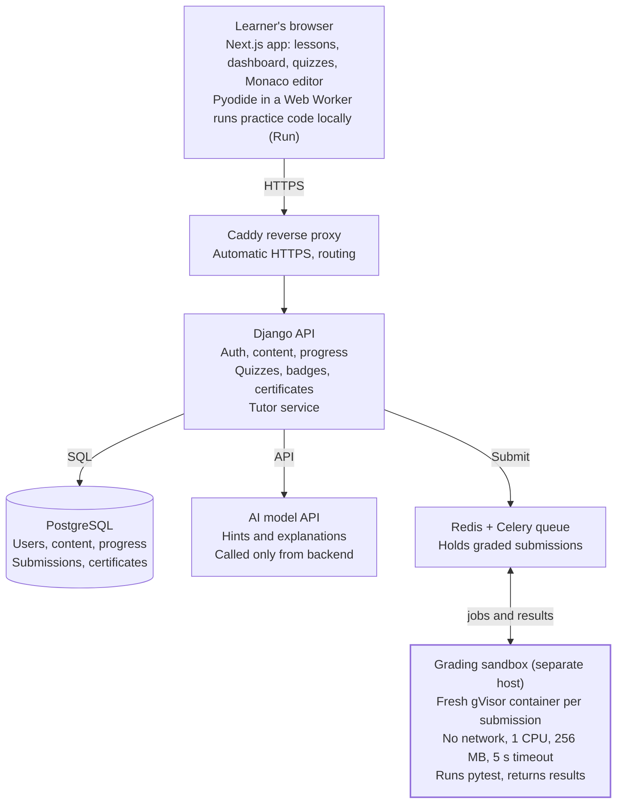
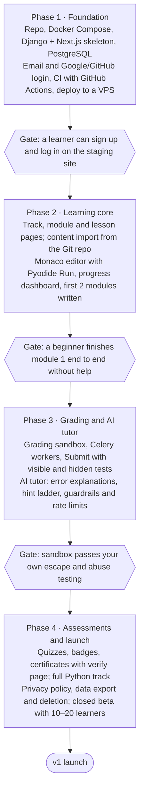

# CodeStart — Software Development Learning Platform

Oct 20, 2026 · Ioan

## Overview

CodeStart takes a complete beginner from "never written code" to building small working programs, by pairing short lessons with hands-on coding in the browser and an AI tutor that guides without giving answers away. CodeStart is a working name.

**Who it is for:** adults and older teens with no programming experience, learning on a laptop, often alone and in short sessions (20–40 minutes).

**Goals for v1**

- A learner can sign up and write and run their first line of code in under 5 minutes, with nothing to install.
- One complete beginner track (Python fundamentals) with lessons, exercises, quizzes and a certificate.
- Every exercise is auto-checked, so learners get instant feedback.
- An AI tutor that gives hints and explains errors in plain language, without handing over full solutions.

**Non-goals for v1**

- Marketplace for outside instructors, payments or subscriptions.
- Live classes, video hosting or forums.
- Multiple languages beyond Python (JavaScript comes after v1).
- Native mobile apps (the web app should still read well on a phone).

## Learners and core journeys

Three beginner types drive the v1 design; all three need instant feedback and help when stuck.

| Persona | Situation | What they need most |
| --- | --- | --- |
| Curious starter | Wants to try coding, unsure it is "for them" | A first win in minutes, friendly tone, no setup |
| Career switcher | Studying evenings toward a tech job | A clear path, visible progress, a certificate to show |
| Student | Learning alongside school or university | Practice exercises, explanations of errors, quizzes |

**Core journeys (v1)**

1. **First visit:** land on the site, open a sample lesson without an account, run code, then sign up to save progress.
2. **Daily learning:** open the dashboard, click "Continue", read a short lesson, solve its exercise, see progress update.
3. **Getting stuck:** a test fails, the learner asks the AI tutor, gets a hint (not the answer), fixes the code, passes.
4. **Finishing a module:** pass the module quiz, earn a badge, unlock the next module.
5. **Finishing the track:** complete all modules and the final project, receive a certificate with a public verification link.

## Courses and lessons

Content is organised as Track → Module → Lesson, and every lesson ends with something the learner does, not just reads.

**Structure**

- **Track:** a full learning path, e.g. "Python Fundamentals" (about 8 modules, 40–60 lessons).
- **Module:** one topic, e.g. "Loops", with 5–8 lessons and a closing quiz.
- **Lesson:** a short explanation (under 5 minutes reading), code examples, then one or more exercises.

**Lesson types**

- Concept: text, examples and a "try it" code block.
- Exercise: a task with starter code and hidden tests.
- Quiz: multiple-choice and "predict the output" questions.
- Project: a larger task at the end of the track, e.g. a text-based game.

**Progress tracking**

- Lesson states: not started, in progress, completed.
- Module and track percentage on the dashboard, a "Continue where you left off" button, and a daily streak counter.
- Modules unlock in order by default; an instructor can turn ordering off.

**Authoring**

- Lessons are written in Markdown files stored in a Git repo (content as code), with front matter for metadata and a folder per exercise holding starter code, solution and tests.
- A simple import command loads the repo into the database, so you edit content in your normal editor and review changes like code.

**Suggested first track: Python Fundamentals**

1. Getting started: print, comments, running code
2. Variables and data types
3. Strings and input
4. Conditions (if / elif / else)
5. Loops (for, while)
6. Lists and dictionaries
7. Functions
8. Errors and debugging
9. Final project

## In-browser code editor

Practice code runs inside the learner's browser (Python compiled to WebAssembly), and only graded submissions run on the server in an isolated sandbox. This keeps v1 cheap, fast and safe.

**Editor experience**

- Monaco editor (the editor behind VS Code): syntax highlighting, line numbers, auto-indent, beginner-friendly theme.
- Buttons: Run, Submit, Reset to starter code, Ask tutor.
- Output panel showing printed output and errors; support for `input()` through a prompt box.
- Code autosaves per exercise, so a refresh never loses work.

**Two ways code runs**

| Mode | Where it runs | Used for | Why |
| --- | --- | --- | --- |
| Run | Learner's browser (Pyodide in a Web Worker) | Trying code, instant output | No server cost, no risk to our servers, works in milliseconds |
| Submit | Server sandbox (isolated container) | Grading exercises that count toward progress and certificates | Learners cannot tamper with tests or results |

**Auto-grading**

- Each exercise has visible tests (shown to the learner) and hidden tests (checked on submit).
- Tests are written with pytest; results come back as a list of pass/fail with friendly messages, e.g. "Expected 10 but your function returned 9".
- Output-only exercises (print this pattern) compare normalised output.
- A time limit (e.g. 5 seconds) catches infinite loops, with a message explaining what happened.

**Beginner-friendly errors**

- Python error messages are rewritten into plain language next to the original, e.g. a `NameError` explains that a variable was used before it was created and points to the line.

## AI tutor

The tutor acts like a patient teaching assistant: it asks questions and gives graduated hints, and it does not write the solution for the learner.

**What it does**

- **Explain an error:** turns a traceback into plain language and points to the likely line.
- **Hint ladder:** three levels per request. Level 1 nudges ("what does your loop do on the last item?"), level 2 names the concept, level 3 shows a similar example that is not the exercise answer.
- **Explain a concept:** re-explains the lesson topic in simpler words or with a new analogy.
- **Review my code:** after a learner passes, comments on readability and suggests one improvement.

**Context it receives**

- Lesson text and learning goal, the learner's current code, the latest test results and error, and the hint level already given.
- The reference solution is given to the tutor marked as private, so it can judge closeness without quoting it.

**Guardrails**

- System prompt rules: no complete solutions, short answers (under ~120 words), beginner vocabulary, encourage the learner to try.
- An output check that blocks replies containing code too similar to the reference solution.
- Rate limits per learner (e.g. 30 tutor messages a day) to control cost and over-reliance.
- Tutor only discusses the lesson and programming; off-topic requests get a polite redirect.
- Learners can rate each reply (helpful / not helpful) to improve prompts over time.

**Model provider**

- Called from the backend only (API key never in the browser) through one tutor service, so the model can be swapped later. A fast, low-cost model fits hints; a stronger model can handle code review.

## Quizzes, badges and certificates

Quizzes close each module, badges reward steady progress, and a verifiable certificate marks track completion.

**Quizzes**

- Question types: multiple choice, "predict the output" of a code snippet, and fill-in-the-blank code.
- 8–10 questions per module quiz, drawn from a larger pool so retakes differ.
- Pass mark 70%; unlimited retakes after a short cooldown (e.g. 10 minutes); each answer shows an explanation.

**Badges**

- Module completion (one per module).
- Streaks: 3, 7 and 30 days.
- Milestones: first program, first 10 exercises, solved without hints.

**Certificates**

- Issued when all modules, quizzes and the final project are passed (server-graded only).
- PDF with learner name, track, date and a unique ID.
- Public verification page (`/verify/<id>`) so employers can confirm it is real.
- Signed record in the database; the ID is random and non-guessable.

## Tech stack and architecture

A Python backend (Django) with a React frontend (Next.js), all in Docker Compose on one VPS for v1; it builds on your Python experience and is easy to self-host.

| Layer | Choice | Why |
| --- | --- | --- |
| Frontend | Next.js (React, TypeScript), Tailwind CSS | Fast pages, large ecosystem, good for SEO on public lessons |
| Code editor | Monaco | Same editor as VS Code, familiar to future developers |
| Browser runtime | Pyodide (Python on WebAssembly) | Run code with no server cost |
| Backend | Django + Django REST Framework | Built-in admin for content and users, mature auth, Python |
| Auth | django-allauth | Email plus Google/GitHub login |
| Database | PostgreSQL | Reliable, JSON fields for test results |
| Job queue | Redis + Celery | Runs grading jobs in the background |
| Grading sandbox | Docker with gVisor runtime | Strong isolation for untrusted code |
| AI tutor | LLM API via a backend tutor service | Key stays server-side, provider swappable |
| Hosting | Docker Compose on a VPS, Caddy for HTTPS | Simple, cheap, one command to deploy |
| CI/CD | GitHub Actions | Tests and deploy on every push |

The Run button never leaves the browser; Submit travels through the API and queue to an isolated sandbox host, and the tutor calls the AI model only from the backend.

## Data model

Twelve core tables cover v1; content tables are loaded from the Git repo, learner tables are written by the app.

| Table | Key fields | Notes |
| --- | --- | --- |
| User | id, email, name, role (learner / instructor / admin), created_at | Auth via email + Google/GitHub login |
| Track | id, slug, title, description, language, published | e.g. python-fundamentals |
| Module | id, track_id, order, title | Ordered within a track |
| Lesson | id, module_id, order, type (concept / exercise / quiz / project), title, body_md | Body stored as Markdown |
| Exercise | id, lesson_id, starter_code, solution_code, visible_tests, hidden_tests, time_limit_s | Solution and hidden tests never sent to the browser |
| Submission | id, user_id, exercise_id, code, status (queued / passed / failed / error), results_json, created_at | One row per Submit |
| LessonProgress | user_id, lesson_id, state, completed_at | Drives dashboard percentages |
| QuizQuestion | id, module_id, type, prompt, options_json, answer, explanation | Pool per module |
| QuizAttempt | id, user_id, module_id, score, passed, created_at | Retakes allowed |
| TutorMessage | id, user_id, exercise_id, role, content, hint_level, rating, created_at | For history, limits and quality review |
| Badge / UserBadge | badge: id, code, title · user_badge: user_id, badge_id, awarded_at | Streaks and milestones |
| Certificate | id (random), user_id, track_id, issued_at, signature | Backs the public verify page |

## Security and privacy

The biggest risk is running untrusted learner code on our servers, so the grading sandbox gets the strictest controls; the rest follows standard web-app practice.

**Code execution sandbox (Submit)**

- Each submission runs in a fresh, throwaway container with gVisor (or Firecracker) isolation, as a non-root user with a read-only root filesystem.
- No network access, CPU and memory limits (e.g. 1 CPU, 256 MB), process count limit, 5-second timeout, output size cap.
- Workers run on a separate host or VM from the web app and database; the queue is the only link between them.
- Hidden tests and solutions are mounted only inside the sandbox and never returned to the client.

**In-browser execution (Run)**

- Pyodide runs in a Web Worker, isolated from the page and session tokens; a strict Content Security Policy limits what it can load.

**Application security**

- OWASP Top 10 baseline: Django ORM (no raw SQL), CSRF protection, output escaping when rendering Markdown, secure cookies, HTTPS only.
- Rate limiting on login, submissions and tutor calls; account lockout and optional 2FA for instructors and admins.
- Secrets (database, AI API key) in environment variables or a secrets manager, never in the repo.
- Prompt-injection awareness: learner code and messages are treated as data in tutor prompts, and the tutor has no tools or access beyond its text reply.

**Privacy (GDPR, as an EU-based platform)**

- Collect only email, name and learning data; clear privacy policy and cookie consent for any analytics.
- Data export and account deletion from the settings page.
- Tutor conversations retained for a limited period (e.g. 90 days) and not used for model training by the provider (check the provider's API terms).

## Roadmap

Build in four phases, and only move on when each gate is met; the riskiest part (running learner code) comes in Phase 3, once the basics work.

Each gate is something you can check by hand before continuing, which matches a pause-and-verify way of working.

**Phase 1, first steps**

1. Create the repo with two folders, `backend/` (Django) and `frontend/` (Next.js), plus a `docker-compose.yml` for Postgres and Redis.
2. Backend: `django-admin startproject codestart backend`, add Django REST Framework and django-allauth, connect to Postgres, run `python manage.py migrate`.
3. Frontend: `npx create-next-app@latest frontend --typescript --tailwind`, add a login page that calls the backend.
4. Add a GitHub Actions workflow that runs backend and frontend tests on every push.
5. Deploy to a small VPS with Docker Compose and Caddy, then check the Phase 1 gate.

## Open questions

- [ ] Final product name and domain (CodeStart is a placeholder).
- [ ] Interface language: English only, Romanian only, or both from day one?
- [ ] Free forever, or a paid plan later? This affects how much AI tutor usage is affordable.
- [ ] Who writes the content: you alone, or invited instructors (needs an instructor role and review flow)?
- [ ] Is Python the right first track, or should it be web basics (HTML/CSS/JS)?
- [ ] Hosting budget per month for the VPS and AI API.
- [ ] Which AI model provider to use for the tutor.
- [ ] Should certificates be free, or a paid add-on?
